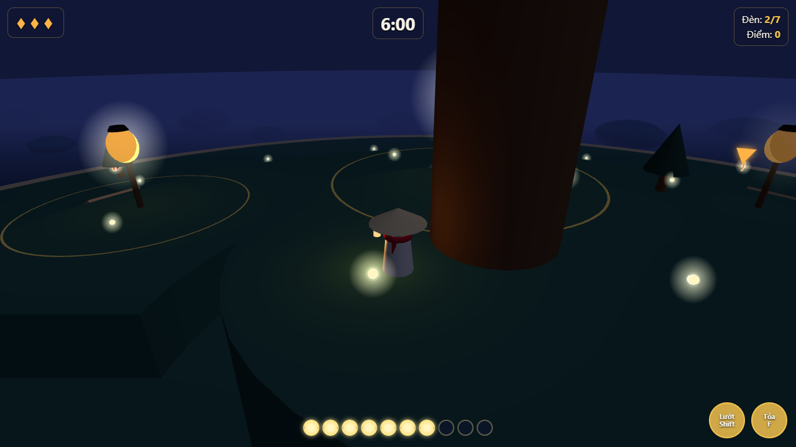

# Đảo Đèn Lồng

> Day 12 · AI SDLC Lab · cá nhân: Dương Thị Huệ (2A202603430)
> Video demo: *(sẽ thêm ở Phase 4)* · Trạng thái: **Phase 3** (tag `phase-3`, Contract v1.2: "Đèn cạn dầu")

Game 3D góc nhìn thứ ba qua **3 Đêm**: Đảo Bến, Đảo Cau, Đảo Chuông. Mây, người giữ đèn nhỏ tuổi đội nón lá, gom đom đóm để thắp lại các Đèn Lồng Lớn, né Bóng Mực và Gió Lạc trong sương đen.



## Cài đặt và chạy (macOS / Linux / Windows, cần Node.js ≥ 18)

```bash
git clone https://github.com/dhuee10/K5-L3A-DAY12-DuongThiHue-2A202603430-AI-SDLC-Dao-Den-Long.git && cd K5-L3A-DAY12-DuongThiHue-2A202603430-AI-SDLC-Dao-Den-Long
npm install
npm start          # rồi mở http://localhost:8080
```

Không có dependency npm. Trình duyệt tải three.js 0.160 từ unpkg nên cần mạng lần đầu. Đổi cổng bằng `PORT=9000 npm start`.

## Điều khiển

| Phím | Hành động |
|---|---|
| W A S D / ↑ ↓ | Đi (theo hướng camera) |
| Space | Nhảy |
| Shift (hoặc K) | Lướt 14 m/s trong 0.2 s, hồi chiêu 1.5 s |
| E | Nạp đom đóm vào Đèn Lồng Lớn gần nhất (trong 2 m) |
| F (hoặc J) | Tỏa sáng: tốn 3 đom đóm, làm choáng và đẩy lùi Bóng Mực trong 5 m, hồi chiêu 3 s |
| ← → / kéo chuột | Xoay camera (độ nhạy chỉnh trong Cài đặt) |
| Esc / P | Tạm dừng: Tiếp tục / Chơi lại Đêm / Cài đặt / Về menu |

## Luật chơi (TICKET-02 + TICKET-03)

- Ba Đêm nối tiếp: menu → giới thiệu Đêm (lời Ông Đăng) → chơi → kết quả → Đêm kế. Thắng Đêm 3 thì thấy màn Bình Minh với tổng điểm. Thua thì chơi lại Đêm đó.
- **Mục tiêu: giữ đảo sáng tới bình minh.** Hết giờ (Đêm 1/2/3 = 240/270/300 s) mà còn ít nhất 3/5, 4/6, 5/7 đèn đang sáng là thắng. Thắp hết đèn không kết thúc Đêm.
- Đèn cần 10 đom đóm (thắp lại đèn từng sáng chỉ cần 5). Đèn sáng cháy 1 dầu/giây (tối đa 100). Bấm E ở đèn đang sáng để **châm dầu** (10 dầu mỗi đom đóm). Hết dầu thì đèn tắt.
- Đèn còn dưới 30 dầu nhấp nháy và **mất vùng an toàn 6 m**: Bóng Mực sẽ tới hút dầu (5/giây). Tỏa sáng trúng con đang hút được +15.
- Sức chứa đom đóm tăng 2 sau mỗi lần thắp thành công (10 → tối đa 20).
- Bóng Mực (4 m/s, Đêm 3: 4.5 m/s) phát hiện Mây ở 12 m. Bị chạm: −1 Ngọn Lửa, rơi một nửa đom đóm ra quanh Mây (nhặt lại được trong 8 s), bất tử 1.5 s.
- Rơi khỏi đảo: −1 Ngọn Lửa, mất hết đom đóm, hồi sinh ở điểm xuất phát.
- **Gió Lạc** (Đêm 2, 3) cướp 3 đom đóm khi Mây mang ≥ 5; tỏa sáng trúng nó để lấy lại. **Bùa Gió**: chạy 7.2 m/s và lướt không hồi chiêu trong 10 s.
- Đêm 2: hai đảo, cầu tre, bục nhảy. Đêm 3: đảo 3 tầng, dốc, bục nhảy lên tháp chuông, gió mạnh mỗi 30 s.
- Cài đặt: âm lượng, độ nhạy chuột, **bảng màu dễ phân biệt** (mù màu), đều được lưu.

### Cách tính điểm (TICKET-03)

| Sự kiện | Điểm |
|---|---|
| Mỗi đom đóm nạp vào đèn (thắp, thắp lại, châm dầu) | +5 |
| Thắp lần đầu / thắp lại | +100 / +40 |
| Bóng Mực trúng Tỏa Sáng (đang hút dầu) | +5 (+15) |
| Bình minh, nếu thắng: mỗi đèn đang sáng | +50 + floor(dầu) |
| Bình minh, nếu thắng: mỗi Ngọn Lửa còn lại | +50 |

Không còn thưởng thời gian. Tổng điểm game là tổng điểm các Đêm đã thắng. Các thay đổi phá vỡ tương thích: [CHANGELOG.md](CHANGELOG.md); quyết định thiết kế: [ADR-001](docs/adr/ADR-001-lantern-fuel-and-dawn-win.md).

## Chế độ headless (Test Contract v1.1)

```bash
node src/headless.mjs --seed 1 --night 1|2|3 --ticks 600 --out out.jsonl [--scenario s.json] [--inputs i.json] [--snapshot-every 10]
```

Khai báo ở [game.contract.json](game.contract.json) (`contract_version` 1.2, toàn bộ số chuẩn + khóa dầu đèn, `fall_enabled: true`). Mã thoát: 0 thành công, 2 nếu file inputs/scenario sai định dạng, 1 nếu thiếu/sai tham số. Một Đêm 3 đầy đủ (18.000 tick) chạy khoảng 0.35 s. Các giả định cho chỗ ticket chưa nói (ví dụ điểm xuất phát Đêm 3 là (0,0,−30) vì (0,0,0) nằm trong tháp chuông) ở [docs/notes/phase-2.md](docs/notes/phase-2.md).

## Kiểm chứng

```bash
npm test          # 57 test: 49 scenario theo yêu cầu (R* Phase 1, P* Phase 2, Q* Phase 3) + định dạng, tất định, exit code, hiệu năng, contract khớp code
npm run proof     # chạy lại toàn bộ scenario qua CLI thật, ghi docs/proof/phase-3/
```

- Spec, giả định, acceptance criteria và bảng truy vết: [phase-3.md](docs/notes/phase-3.md) · [phase-2.md](docs/notes/phase-2.md) · [phase-1.md](docs/notes/phase-1.md)
- Kết quả headless: [docs/proof/phase-3/RESULTS.md](docs/proof/phase-3/RESULTS.md)
- Trình duyệt thật (luồng 3 Đêm với luật bình minh, tạm dừng, cài đặt + mù màu, FPS 60 ở 1280×720): [docs/proof/phase-3/browser-check.json](docs/proof/phase-3/browser-check.json)
- CI (GitHub Actions, Ubuntu + macOS): test + proof + kiểm tra output khớp bản đã commit.

## Sáng tạo của tôi

Tất cả chỉ nằm ở phần hiển thị ([src/game.js](src/game.js)), không chạm vào `src/sim.mjs`, nên đầu ra headless không đổi.

1. **Đèn trời:** mỗi khi một Đèn Lồng Lớn được thắp, 6 chiếc đèn trời nhỏ bay lên từ đèn.
2. **Đèn trên nón của Mây sáng theo số đom đóm đang mang.**
3. **Âm thanh tự sinh bằng WebAudio** (không dùng file): nhạc đêm ngũ cung, nhặt đom đóm kêu theo thang ngũ cung, thắp đèn có hợp âm.
4. **Vòng an toàn** 6 m vẽ trên mặt đất quanh đèn đã thắp; *(Phase 3)* vòng tự ẩn khi đèn dưới 30 dầu, đúng lúc đèn mất vùng an toàn.
5. *(Phase 2)* **Đom đóm rơi nhấp nháy** trong 2 s cuối trước khi biến mất, và **Bóng Mực "mọc" dần lên** trong lúc `spawning`.
6. *(Phase 2)* **Lời Ông Đăng** riêng cho từng Đêm ở màn giới thiệu, và lời cảm ơn ở màn Bình Minh.
7. *(Phase 3)* **Mũi tên chỉ đường** giờ chỉ cả tới đèn sắp cạn dầu, không chỉ đèn chưa sáng; đèn tắt kêu ba nốt trầm.

Bằng chứng phần lõi vẫn đúng: `npm test` xanh, `npm run proof` ALL PASS với hash tất định. Ảnh: [shot-n1](docs/proof/phase-2/shot-n1.png), [shot-n2](docs/proof/phase-2/shot-n2.png), [shot-n3](docs/proof/phase-2/shot-n3.png).

## Cấu trúc

```
src/sim.mjs        luật game, thuần và tất định (dùng chung cho game + headless)
src/maps.mjs       bản đồ chuẩn 3 Đêm + độ cao mặt đất
src/headless.mjs   CLI theo Test Contract
src/game.js        hiển thị three.js, âm thanh, bàn phím
index.html         HUD, màn hình bắt đầu/kết thúc
tests/             scenario theo yêu cầu + test CLI
tools/             serve.mjs, proof.mjs, browser-check.mjs, stop-hook.mjs
docs/notes/        PRD-0 tóm tắt, giả định, nhật ký AI, đánh giá
docs/proof/        bằng chứng từng phase
AGENTS.md, CLAUDE.md, .claude/ (hook + skill), .github/workflows/ci.yml   harness AI
```

## Tài liệu lab

[GUIDE](GUIDE.md) · [CHECKPOINTS](CHECKPOINTS.md) · [SUBMISSION](SUBMISSION.md) · [RULES](RULES.md) · [RUBRIC](RUBRIC.md) · [Lab board](https://claude.ai/artifact/Q1RYyv1dxjUczzCbd2ZnoW)
