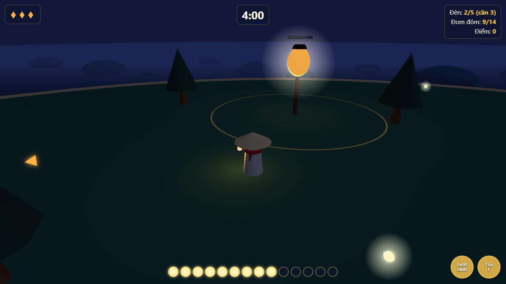

# Đảo Đèn Lồng

> Day 12 · AI SDLC Lab · cá nhân: Dương Thị Huệ (2A202603430) · **v1.0.0** (tag `phase-4`, Contract v1.3)
> **Video demo:** [docs/demo/demo.mp4](docs/demo/demo.mp4) (nếu chưa có ở đây thì xem phần tải về của [Release v1.0.0](https://github.com/dhuee10/K5-L3A-DAY12-DuongThiHue-2A202603430-AI-SDLC-Dao-Den-Long/releases/tag/v1.0.0))

Game 3D góc nhìn thứ ba qua **3 Đêm** (Đảo Bến, Đảo Cau, Đảo Chuông). Mây, người giữ đèn nhỏ tuổi đội nón lá, gom đom đóm để thắp các Đèn Lồng Lớn và **giữ cho đảo còn sáng tới bình minh**, trong khi Bóng Mực tìm tới những ngọn đèn yếu để hút dầu.



## Yêu cầu hệ thống

- **Node.js ≥ 18** (không cần package npm nào; three.js r160 đã kèm sẵn trong `vendor/`, chạy được không cần mạng).
- Trình duyệt có WebGL2: Chrome, Edge, Firefox hoặc Safari bản mới. Lệnh benchmark cần **Chrome/Chromium/Edge** (tự tìm, hoặc đặt `CHROME_PATH`).
- macOS, Linux hoặc Windows. Đã đo: Intel Core Ultra 5 125H, Intel Arc iGPU, 16 GB RAM, Windows 11.

## Cài đặt và chạy (3 lệnh)

```bash
git clone https://github.com/dhuee10/K5-L3A-DAY12-DuongThiHue-2A202603430-AI-SDLC-Dao-Den-Long.git && cd K5-L3A-DAY12-DuongThiHue-2A202603430-AI-SDLC-Dao-Den-Long
npm install
npm start            # rồi mở http://localhost:8080
```

Đổi cổng: `PORT=9000 npm start`. Bản phát hành (thư mục web tĩnh + server) ở [Release v1.0.0](https://github.com/dhuee10/K5-L3A-DAY12-DuongThiHue-2A202603430-AI-SDLC-Dao-Den-Long/releases/tag/v1.0.0): giải nén, chạy `node tools/serve.mjs`.

## Điều khiển (mặc định, đổi được trong Cài đặt)

| Phím | Hành động |
|---|---|
| W A S D (hoặc ↑ ↓) | Đi |
| Space | Nhảy |
| Shift | Lướt (14 m/s, 0.2 s, hồi 1.5 s) |
| E | Nạp đom đóm để thắp đèn, hoặc châm dầu cho đèn đang sáng |
| F | Tỏa sáng (tốn 3 đom đóm, choáng Bóng Mực trong 5 m) |
| Kéo chuột / ← → | Xoay camera |
| Esc | Tạm dừng: Tiếp tục / Chơi lại Đêm / Cài đặt / Về menu |

**Cài đặt** (lưu giữa các lần mở game): âm lượng, độ nhạy chuột, **đổi phím cho mọi hành động** (báo trùng phím, có "Khôi phục mặc định"), **bảng màu dễ phân biệt**, **giảm chuyển động** (tắt rung camera và chớp màn hình), **chữ lớn ×1.25**. Chữ giao diện luôn ≥ 18 px ở 1280×720. Phụ đề/chỉ báo hình ảnh cho: Bóng Mực xuất hiện (kèm mũi tên ở mép màn hình), gió sắp thổi, 10 giây cuối, đèn dưới 30 dầu.

## Luật chơi

- Menu → giới thiệu Đêm (lời Ông Đăng) → chơi → kết quả → Đêm kế. Thắng Đêm 3 thì thấy màn **Bình Minh** với tổng điểm. Thua thì chơi lại Đêm đó.
- **Thắng:** còn sống khi hết giờ (240/270/300 s) và còn ít nhất 3/5, 4/6, 5/7 đèn đang sáng. **Thua:** hết 3 Ngọn Lửa, hoặc bình minh mà thiếu đèn.
- Đèn cần 10 đom đóm (thắp lại chỉ cần 5), cháy 1 dầu/giây (tối đa 100); bấm E để châm (10 dầu mỗi đom đóm). Dưới 30 dầu đèn nhấp nháy và mất vùng an toàn 6 m, Bóng Mực tới hút dầu.
- Sức chứa đom đóm 10, tăng 2 sau mỗi lần thắp (tối đa 20). Bị Bóng Mực chạm: −1 lửa, rơi một nửa đom đóm. Rơi khỏi đảo: −1 lửa, mất hết đom đóm.
- Gió Lạc (Đêm 2–3) cướp 3 đom đóm. Bùa Gió: chạy nhanh, lướt không hồi chiêu trong 10 s. Đêm 3 có gió mạnh mỗi 30 s.

**Điểm:** +5 mỗi đom đóm nạp vào đèn · +100 thắp lần đầu · +40 thắp lại · +5 mỗi Bóng Mực trúng Tỏa Sáng (+15 nếu nó đang hút dầu) · khi thắng: mỗi đèn sáng +50 + floor(dầu), mỗi lửa +50. Tổng điểm game = tổng các Đêm đã thắng.

**Bảng xếp hạng cục bộ:** sau Bình Minh hoặc sau khi thua, nhập tên (3–12 ký tự chữ/số/_, **có dấu tiếng Việt cũng được**). Top 10 lưu trên đĩa ở `data/leaderboard.json`, xem từ menu "Bảng xếp hạng". Xuất ra file: `node tools/serve.mjs --export-leaderboard out.json`.

## Test, headless, bench, soak

```bash
npm test                                   # 64 test: scenario theo yêu cầu cả 4 phase, CLI, tất định, leaderboard, bench, soak
npm run proof                              # chạy lại mọi scenario qua CLI thật, ghi docs/proof/phase-4/RESULTS.md
node src/headless.mjs --seed 1 --night 1 --ticks 600 --out out.jsonl [--scenario s.json] [--inputs i.json] [--snapshot-every 10]
node tools/bench.mjs --seed 42 --duration 30 --out bench.json            # mở cửa sổ Chrome 1280x720, vsync tắt
node --expose-gc --jitless --max-semi-space-size=1 tools/soak.mjs --seed 7 --nights 10 --out soak.json
```

Mọi lệnh khai báo trong [game.contract.json](game.contract.json) (v1.3).

| Đo (máy của tôi, xem trên) | Kết quả | Ngưỡng |
|---|---|---|
| [bench.json](docs/proof/phase-4/bench.json): avg / p1 low / load | **131.7 FPS / 62.4 FPS / 550 ms** | ≥ 60 / ≥ 30 / ≤ 10000 |
| [soak.json](docs/proof/phase-4/soak.json): crashes, mem_end / mem_start | **0, 42.2 / 40.4 MB = 1.045** | 0, ≤ 1.2 |
| Headless Đêm 3 đầy đủ (18 000 tick) | ~0.35 s | ≤ 30 s |

- **Benchmark:** vsync tắt bằng cờ Chrome `--disable-gpu-vsync --disable-frame-rate-limit`. `peak_mem_mb` là tổng RSS của mọi tiến trình trình duyệt trong lúc đo (bản web: không đo riêng được tab game).
- **Soak** chạy với `--jitless`: heap JS đứng yên (~5 MB) suốt 60 Đêm. Phần RSS tăng thêm khi bật JIT là mã máy V8 biên dịch ra, không phải rò rỉ: với cờ mặc định tỉ lệ dao động 1.19–1.25 ([soak-default-v8-flags.json](docs/proof/phase-4/soak-default-v8-flags.json)). Phân tích ở [phase-4.md](docs/notes/phase-4.md).

## Sáng tạo của tôi

Tất cả chỉ ở phần hiển thị ([src/game.js](src/game.js)), không chạm luật trong `src/sim.mjs`, nên đầu ra headless không đổi. Trong cảnh benchmark chúng không xuất hiện (không có sự kiện thắp đèn, không nhạc).

1. **Đèn trời** bay lên mỗi khi thắp một Đèn Lồng Lớn.
2. **Đèn trên nón Mây** sáng theo số đom đóm đang mang.
3. **Âm thanh tự sinh bằng WebAudio** (không có file âm thanh): nhạc đêm ngũ cung, chuông khi nhặt/thắp/châm.
4. **Vòng an toàn** vẽ trên đất, tự ẩn khi đèn dưới 30 dầu.
5. **Đom đóm rơi nhấp nháy** trước khi biến mất; **Bóng Mực "mọc" dần** lúc xuất hiện.
6. **Lời Ông Đăng** riêng cho từng Đêm và lời cảm ơn ở màn Bình Minh.
7. **Mũi tên chỉ đường** tới đèn chưa sáng hoặc sắp cạn dầu.

## Tài liệu

| | |
|---|---|
| Yêu cầu từng phase | [PRD-0](docs/notes/PRD-0.md) · [TICKET-02](docs/notes/TICKET-02.md) · [TICKET-03](docs/notes/TICKET-03.md) · [TICKET-04](docs/notes/TICKET-04.md) |
| Giả định, acceptance criteria, bằng chứng | [phase-1](docs/notes/phase-1.md) · [phase-2](docs/notes/phase-2.md) · [phase-3](docs/notes/phase-3.md) · [phase-4](docs/notes/phase-4.md) |
| Quyết định thiết kế | [ADR-001 dầu đèn + luật bình minh](docs/adr/ADR-001-lantern-fuel-and-dawn-win.md) |
| Retro | [docs/notes/retro.md](docs/notes/retro.md) |
| Thay đổi / nguồn / giấy phép | [CHANGELOG](CHANGELOG.md) · [CREDITS](CREDITS.md) · [LICENSE](LICENSE) |
| Harness AI | [AGENTS.md](AGENTS.md), [CLAUDE.md](CLAUDE.md), [Stop hook](.claude/settings.json) ([tools/stop-hook.mjs](tools/stop-hook.mjs)), [skill verify](.claude/skills/verify/SKILL.md), [CI](.github/workflows/ci.yml) |
| Tài liệu lab | [GUIDE](GUIDE.md) · [CHECKPOINTS](CHECKPOINTS.md) · [SUBMISSION](SUBMISSION.md) · [RULES](RULES.md) · [RUBRIC](RUBRIC.md) |

## Cấu trúc

```
src/sim.mjs          luật game, thuần và tất định (game + headless + bench + soak dùng chung)
src/maps.mjs         bản đồ chuẩn 3 Đêm
src/headless.mjs     CLI theo Test Contract
src/leaderboard.mjs  luật bảng xếp hạng
src/benchstats.mjs   công thức đo benchmark + đường bay camera
src/game.js          three.js, menu, HUD, âm thanh, cài đặt, trợ năng
index.html           giao diện
vendor/              three.js r160 (MIT)
tools/               serve (run_cmd), bench, soak, proof, browser-check, stop-hook
tests/               scenario R*/P*/Q* + test Phase 4
docs/                notes, adr, proof (bằng chứng từng phase), demo
```
