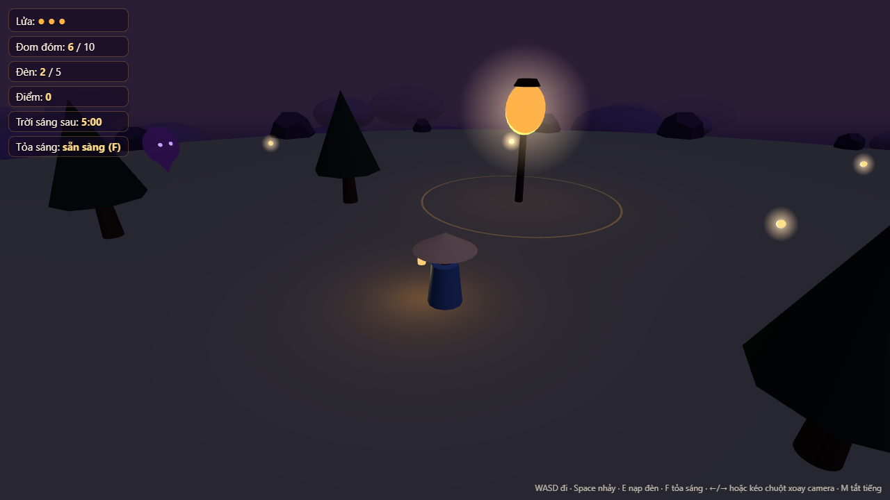

# Đảo Đèn Lồng

> Day 12 · AI SDLC Lab · cá nhân: Dương Thị Huệ (2A202603430)
> Video demo: *(sẽ thêm ở Phase 4)* · Trạng thái: **Phase 1** (tag `phase-1`)

Game 3D góc nhìn thứ ba. Mây, người giữ đèn nhỏ tuổi đội nón lá, gom đom đóm để thắp lại 5 Đèn Lồng Lớn của Đảo Bến và né Bóng Mực trong sương đen.



## Cài đặt và chạy (macOS / Linux / Windows, cần Node.js ≥ 18)

```bash
git clone https://github.com/dhuee10/K5-L3A-DAY12-DuongThiHue-2A202603430-AI-SDLC-Dao-Den-Long.git && cd K5-L3A-DAY12-DuongThiHue-2A202603430-AI-SDLC-Dao-Den-Long
npm install
npm start          # rồi mở http://localhost:8080
```

Không có dependency npm. Trình duyệt tải three.js 0.160 từ unpkg nên cần mạng lần đầu. Đổi cổng bằng `PORT=9000 npm start`.

## Điều khiển

| Phím | Hành động |
|---|---|
| W A S D / ↑ ↓ | Đi (theo hướng camera) |
| Space | Nhảy |
| E | Nạp đom đóm vào Đèn Lồng Lớn gần nhất (trong 2.5 m) |
| F (hoặc J) | Tỏa sáng: tốn 1 đom đóm, làm choáng và đẩy lùi Bóng Mực trong 6 m |
| ← → / kéo chuột | Xoay camera |
| R / Enter | Chơi lại sau khi thắng/thua |
| M | Tắt/bật tiếng |

## Luật chơi

- Đi gần đom đóm (≤ 1 m) để tự nhặt, mang tối đa **10**.
- Mỗi Đèn Lồng Lớn cần **5** đom đóm. Nạp từng phần cũng được.
- Bóng Mực đuổi theo Mây (3.5 m/s, Mây chạy 6 m/s). Bị chạm (≤ 1 m) thì mất 1 ngọn lửa và **rơi mất một nửa** số đom đóm đang mang (làm tròn xuống), sau đó bất tử 1.5 s.
- Bóng Mực **không vào được vòng 4 m quanh đèn đã thắp** (vòng vàng trên mặt đất).
- Thắp đủ 5 đèn = **thắng**. Hết 3 ngọn lửa = **thua** (`no_flames`). Hết 300 s mà chưa đủ đèn: trời sáng = **thua** (`dawn`).

### Cách tính điểm

| Sự kiện | Điểm |
|---|---|
| Nhặt 1 đom đóm | +10 |
| Thắp 1 đèn | +100 |
| Mỗi Bóng Mực bị choáng bởi một lần tỏa sáng | +25 |
| Khi **thắng**: mỗi giây còn lại (làm tròn xuống) | +1 |
| Khi **thắng**: mỗi ngọn lửa còn lại | +50 |

Thua thì không có thưởng cuối màn.

## Chế độ headless (Test Contract v1.0)

```bash
node src/headless.mjs --seed 1 --night 1 --ticks 600 --out out.jsonl [--scenario s.json] [--inputs i.json] [--snapshot-every 10]
```

Khai báo đầy đủ ở [game.contract.json](game.contract.json). Mã thoát: 0 thành công, 2 nếu file inputs/scenario sai định dạng, 1 nếu thiếu/sai tham số. `fall_enabled: false`: đảo có tường vô hình ở bán kính 40 m nên không thể rơi, vì vậy không bao giờ có `player_hit` với `by: "fall"`. Mọi tuning khác đều được dùng (không có giá trị `null`).

## Kiểm chứng

```bash
npm test          # 22 test: 16 scenario theo yêu cầu + định dạng, tất định, exit code, contract khớp code
npm run proof     # chạy lại toàn bộ scenario qua CLI thật, ghi docs/proof/phase-1/
```

- Bảng truy vết yêu cầu → bằng chứng: [docs/notes/phase-1.md](docs/notes/phase-1.md)
- Kết quả sinh tự động: [docs/proof/phase-1/RESULTS.md](docs/proof/phase-1/RESULTS.md)
- CI (GitHub Actions, Ubuntu + macOS): test + proof + kiểm tra output khớp bản đã commit.

## Sáng tạo của tôi

Tất cả chỉ nằm ở phần hiển thị ([src/game.js](src/game.js)), không chạm vào `src/sim.mjs`, nên đầu ra headless không đổi.

1. **Đèn trời:** mỗi khi một Đèn Lồng Lớn được thắp, 6 chiếc đèn trời nhỏ bay lên từ đèn và trôi dần lên bầu trời, đêm càng về sau trời càng nhiều đèn.
2. **Đèn trên nón của Mây sáng theo số đom đóm đang mang:** nhìn là biết túi gần đầy.
3. **Âm thanh tự sinh bằng WebAudio** (không dùng file): nhặt đom đóm kêu theo thang ngũ cung, thắp đèn có hợp âm, bị chạm có tiếng trầm. Phím M để tắt.
4. **Vòng an toàn** vẽ trên mặt đất quanh đèn đã thắp, để người chơi thấy rõ chỗ Bóng Mực không vào được.

Bằng chứng phần cũ vẫn đúng: `npm test` xanh và `npm run proof` cho cùng hash output (bảng tất định trong RESULTS.md). Ảnh: [shot-showcase.png](docs/proof/phase-1/shot-showcase.png) (đèn trời, vòng an toàn, đèn trên nón).

## Cấu trúc

```
src/sim.mjs        luật game, thuần và tất định (dùng chung cho game + headless)
src/headless.mjs   CLI theo Test Contract
src/game.js        hiển thị three.js, âm thanh, bàn phím
index.html         HUD, màn hình bắt đầu/kết thúc
tests/             scenario theo yêu cầu + test CLI
tools/             serve.mjs, proof.mjs, stop-hook.mjs
docs/notes/        PRD-0 tóm tắt, giả định, nhật ký AI, đánh giá
docs/proof/        bằng chứng từng phase
AGENTS.md, CLAUDE.md, .claude/ (hook + skill), .github/workflows/ci.yml   harness AI
```

## Tài liệu lab

[GUIDE](GUIDE.md) · [CHECKPOINTS](CHECKPOINTS.md) · [SUBMISSION](SUBMISSION.md) · [RULES](RULES.md) · [RUBRIC](RUBRIC.md) · [Lab board](https://claude.ai/artifact/Q1RYyv1dxjUczzCbd2ZnoW)
